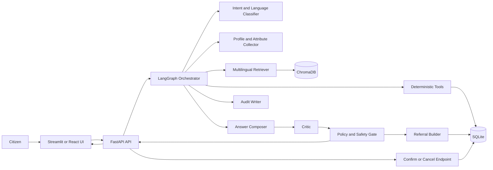
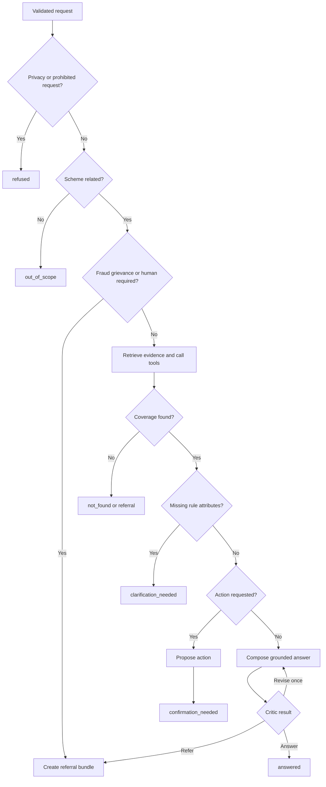

# SchemeSathi Detailed End to End Workflow

## 1 Purpose and operating principle

SchemeSathi is a multilingual citizen scheme navigator for the fictional state of Mitrapur Pradesh. It must answer scheme questions in English, Hindi, Kannada, Tamil, and mixed or Roman-script variants such as Hinglish. It must ground factual statements in the knowledge base, decide eligibility through deterministic code, protect personal data, require confirmation before any state-changing action, and refer cases to a human when policy requires it.

The central design rule is a strict separation of responsibility:

- The language model classifies requests, extracts attributes, supports multilingual phrasing, and explains verified results.
- Deterministic code applies eligibility rules, source precedence, referral policy, action policy, privacy checks, and response validation.
- SQLite is the source of truth for schemes, rules, citizen records, documents, centres, actions, referrals, and policies.
- ChromaDB retrieves relevant unstructured evidence, but retrieved text never directly determines eligibility.
- Every response passes through a critic and a policy gate before it reaches the citizen.

## 2 High level architecture

## 3 System preparation workflow

### 3.1 Define configuration and contracts

1. Create environment-based configuration for the local LLM, embedding model, database paths, vector-store path, critic threshold, retrieval top-k, and optional cloud fallback.
2. Keep `MOCK_LLM=true` support so routing, tools, confirmations, referrals, and tests can run without the model.
3. Define Pydantic v2 models for every request, response, classifier result, tool result, critic result, action preview, referral bundle, citation, and audit event.
4. Restrict enums to the contract values, including intents, languages, answer types, action types, action statuses, and the four eligibility verdicts.
5. Reject or safely repair invalid structured model output. Do not allow free-form model text to become control state.

### 3.2 Build the knowledge base

1. Create at least eight fictional schemes across at least four benefit types.
2. Give every scheme names in English, Hindi, Kannada, and Tamil.
3. Produce at least 25 source documents, including guidelines, FAQs, process notes, circulars, amendments, policies, and resolved grievances.
4. Ensure at least 12 documents are non-English, with at least three each in Hindi, Kannada, and Tamil.
5. Include at least 12 circulars or amendments, including:
   - at least three that change an earlier rule;
   - at least one future-effective change;
   - at least one scheme closure.
6. Include at least 25 resolved grievances and queries, with human-escalation cases and deliberately outdated resolutions.
7. Create policy documents for application fees, appointment lead time, action expiry, referral SLAs, grievance timelines, maximum questions per turn, and critic thresholds.
8. Record every item in `source_register.csv` with source ID, type, language, authority, scheme, dates, supersession, provenance, and synthetic status.
9. Validate that all cited sections and IDs actually exist.

### 3.3 Ingest and index documents

For each source:

1. Validate Source Register metadata and date formats.
2. Treat document text as untrusted data; strip or neutralise embedded instructions for control purposes.
3. Split content by semantic section while preserving source ID, section, scheme ID, language, authority level, effective date, valid-until date, and last-updated date.
4. Embed each chunk with the chosen multilingual embedding model.
5. Persist chunks in ChromaDB.
6. Store the source record and structured scheme data in SQLite.
7. Run retrieval smoke tests in both directions for English, Hindi, Kannada, and Tamil.
8. Reject ingestion atomically if indexing or database validation fails, or mark the source unavailable until both stores are consistent.

### 3.4 Build synthetic structured data

1. Generate at least 30 fictional citizens across three districts, rural and urban areas, and all four preferred languages.
2. Include at least five citizens without consent.
3. Deliberately create boundary cases: exact income limit, one rupee over, exact age, one day short, exact land cap, overlapping eligibility, existing application, rejected application, missing attributes, deadline today, and deadline yesterday.
4. Generate applications, appointments, centres, rules, and policy rows using the fixed Annex C schemas.
5. Reserve judge namespaces and never use them in team data.
6. Validate schema, foreign keys, date consistency, allowed values, non-negative numbers, disability ranges, consent handling, fake phone numbers, and application status logic.
7. Save the verbatim generation prompts, model details, generator, validator, validation output, and data card.

### 3.5 Load deterministic tables

Load and validate these SQLite tables:

- schemes
- eligibility_rules
- required_documents
- service_centres
- citizens
- applications
- appointments
- reminders
- actions
- policy_registry
- referrals

Every eligibility rule and policy value must link to a source ID and section. Database constraints and loader validation should prevent malformed operators, broken dates, duplicate IDs, invalid foreign keys, and reserved judge IDs.

## 4 Runtime request workflow for POST ask

### 4.1 Receive and validate the request

1. Accept the citizen message, optional conversation ID, channel, optional requested language, and `as_of_date`.
2. Read the citizen identity only from the `X-Citizen-Id` header. Never infer it from message text.
3. Default an absent identity to a guest session.
4. Generate a unique trace ID and create or resume the conversation.
5. Validate message length, channel, language enum, and ISO date.
6. Redact secrets and sensitive identifiers before logging.
7. Store only the minimum safe event needed for auditability.

### 4.2 Perform pre-routing safety checks

Run deterministic checks before model-based routing:

- Detect OTPs, bank-account numbers, 12-digit national IDs, phone numbers, and other configured PII.
- Detect requests for another citizen's information and route them to refusal without confirming whether that citizen exists.
- Detect obvious prompt injection in citizen text, while still preserving the message as data for classification.
- Detect direct requests to submit, approve, reject, or otherwise perform a Tier 3 action and route them to refusal or referral.
- Detect common fraud cues, including requests for a fee, OTP, or bank details to release scheme money.

### 4.3 Classify intent, language, and urgency

Call the classifier with a strict schema containing:

- intent;
- language and script;
- urgency;
- sentiment;
- attributes mentioned;
- PII detected;
- tools needed;
- confidence.

Validate the result. On invalid output, retry once with a repair prompt or use a safe deterministic fallback. If language remains ambiguous, ask the citizen which language to use. Override model routing when deterministic safety signals require refusal or referral.

### 4.4 Resolve profile and consent

1. If the header identifies a known citizen and `consent_given = Y`, load the profile.
2. If consent is `N`, treat the person as a guest and do not use profile fields.
3. Import only attributes required by the schemes currently in play.
4. Mark sensitive attributes such as category and disability for restricted use.
5. Merge profile attributes, confirmed conversation attributes, and newly extracted message attributes using this order:
   - newly and explicitly confirmed value;
   - earlier confirmed conversation value;
   - consented profile value.
6. If values conflict, ask for confirmation instead of silently choosing.
7. Never ask again for an attribute already confirmed unless the citizen changes it or a genuine conflict exists.

### 4.5 Select the processing route

| Intent | Primary route |
|---|---|
| discovery | retrieve candidate schemes, identify required attributes, run rule engine across candidates |
| eligibility_check | identify scheme, collect missing attributes, call rule engine |
| documents | call scheme and required-document tools, retrieve supporting source |
| status_deadline | call scheme/date tools, apply source precedence, retrieve amendments or closure notices |
| service_visit | find centres, build a proposed action, wait for confirmation |
| application_draft | inspect profile/application context, build a draft preview, wait for confirmation |
| grievance | collect minimal context, retrieve applicable policy, create referral |
| fraud_report | warn using the no-fee policy and offer or create fraud-desk referral |
| out_of_scope | return out-of-scope response without scheme speculation |

### 4.6 Retrieve grounded evidence

1. Build a retrieval query using the citizen message, detected intent, candidate scheme names, and controlled translations or multilingual embeddings.
2. Search guidelines, circulars, amendments, FAQs, and resolved grievances in ChromaDB.
3. Filter or rerank by scheme, district applicability, `as_of_date`, validity, authority, and language relevance.
4. Retrieve enough context to support the answer, not merely semantically similar text.
5. Preserve exact source metadata for citations.
6. Treat grievance resolutions as historical evidence only.
7. If no adequate source is found, return `not_found` or refer according to policy; never fill gaps from model memory.

### 4.7 Apply source precedence

For every factual claim:

1. Remove sources that do not apply to the scheme, district, or `as_of_date`.
2. Apply explicit amendments and closures only to the named clause and only from their effective date.
3. Prefer current guidelines, government orders, and policy documents over lower-authority material.
4. Prefer live deterministic tool results for current operational state.
5. Use FAQs and grievances only when they do not contradict higher-authority sources.
6. Between equally authoritative sources, use the more recently updated source.
7. If the conflict remains unresolved, record both sources and refer.
8. If a newer amendment conflicts with the loaded rule rows, mark the eligibility result provisional and return `verify_with_officer`.

## 5 Deterministic eligibility workflow

### 5.1 Direct eligibility endpoint

`POST /eligibility` accepts attributes and optional scheme IDs and invokes only the rule engine. No LLM participates in the verdict.

### 5.2 Rule evaluation algorithm

For each applicable scheme:

1. Load active rules for `as_of_date`.
2. Validate scheme status and application dates.
3. Compare each supplied attribute using the configured operator: `<=`, `>=`, `=`, `!=`, `in`, or `not_in`.
4. Return `passed`, `failed`, or `unknown` for every rule.
5. Treat rules in the same non-empty `rule_group` as OR alternatives.
6. Treat all standalone rules and all completed groups as AND conditions.
7. Determine exactly one verdict:
   - `appears_eligible` when every required condition passes and nothing is unknown;
   - `not_eligible` when a required rule fails and no alternative in its group passes;
   - `need_more_information` when nothing fails but required information is missing;
   - `verify_with_officer` when rules conflict with newer sources or dates are uncertain.
8. Return the scheme, verdict, per-rule results, missing attributes, conflicting sources, and cited rule sources.
9. Ensure the same structured facts produce the same verdict regardless of input language.

### 5.3 Progressive information gathering

When the verdict is `need_more_information`:

1. Rank missing attributes by how many candidate schemes they disambiguate.
2. Remove any attribute already confirmed.
3. Ask no more than two questions in the current turn.
4. Explain briefly why each item is needed.
5. Avoid sensitive questions unless an active rule explicitly requires them.
6. Save the requested fields in conversation state.
7. On the next turn, merge the new answers and rerun the complete rule evaluation.
8. Return `clarification_needed` until a conclusive or referable outcome exists.

## 6 Answer composition workflow

The composer receives only verified evidence and tool results. It must:

1. Respond in the citizen's language and script unless another language was requested.
2. Use plain language, short sentences, and explanations for unfamiliar administrative terms.
3. Show the scheme name in the citizen's script and in English.
4. Preserve numbers, dates, amounts, source IDs, and verdict meaning across languages.
5. Cite every factual claim with source ID, section, scheme, effective date, and last-updated date in structured response metadata.
6. For eligibility, show the rule-by-rule outcome in plain language.
7. Say `appears eligible to apply`, never promise approval or payment.
8. State that the department makes the final decision.
9. Clearly distinguish mandatory and optional documents.
10. Mention current closure, extension, deadline, or upcoming change when relevant.
11. Never echo OTPs, full IDs, bank details, or unnecessary PII.

## 7 Critic and final policy gate

### 7.1 Structured critique

Evaluate every draft for:

- groundedness against retrieved sources and tool output;
- coverage of the request;
- correct language and script;
- preservation of numbers and dates;
- PII or secret leakage;
- promise risk;
- citation support;
- consistency with the eligibility verdict and source precedence.

The critic returns `answer`, `revise`, or `refer` with structured scores and reasons.

### 7.2 Revision limit

1. If the critic says `answer`, continue to the policy gate.
2. If it says `revise`, allow exactly one revision.
3. Critique the revised draft again.
4. If the same material problem remains, refer.
5. Do not expose chain-of-thought; save only structured scores, reasons, and decisions.

### 7.3 Deterministic final gate

Before returning the response, code verifies:

- answer type is valid;
- citations exist and were retrieved;
- required caveats are present;
- the response does not contain a prohibited promise;
- no unredacted PII or secret appears;
- language and numeric consistency checks pass;
- referral policy has been applied;
- action state matches the answer type;
- audit fields are complete.

## 8 Referral workflow

Refer when policy requires it, including:

- unresolved low groundedness after one revision;
- rejection disputes, excessive delays, bribe demands, or harassment;
- fraud reports;
- explicit requests for a human;
- strong frustration combined with repeated contact;
- required tool failure;
- `verify_with_officer` verdict;
- unresolved source conflict;
- uncovered questions where the citizen needs an outcome;
- legal advice requests.

Referral steps:

1. Select the queue, such as grievance, department helpdesk, or fraud desk.
2. Compute priority from urgency, harm, fraud, repeated contact, and applicable SLA.
3. Build the Annex D bundle with intent, urgency, sentiment, reasons, citizen summary, evidence, attempted answer, and unresolved questions.
4. Redact PII and secrets from every field.
5. Persist the referral and bundle in SQLite.
6. Return `answer_type = referred`, the referral ID, an honest citizen-facing message, and only SLA commitments supported by policy.
7. Do not promise the referral outcome.

Avoid unnecessary referral when an answer or eligibility result is well-supported and safe.

## 9 Safe action workflow

All actions follow `propose -> confirm -> execute -> verify`.

### 9.1 Propose

1. Determine the action tier.
2. Reject or refer Tier 3 actions, including submission, approval, rejection, or rule changes.
3. For Tier 1 or Tier 2, load relevant citizen, scheme, centre, application, and policy data.
4. Validate ownership, consent, lead time, availability, and required fields.
5. Build a human-readable preview.
6. Store the action as `pending` with the citizen ID, payload, creation time, and policy-driven expiry.
7. Return `confirmation_needed` and the pending action. Execute nothing.

### 9.2 Confirm

The citizen calls `POST /actions/{action_id}/confirm` separately.

1. Authenticate with `X-Citizen-Id` and require an exact ownership match.
2. Load the action inside a database transaction.
3. If already executed, return the original result for idempotency.
4. If cancelled or expired, do not execute.
5. Revalidate availability, policy, and payload immediately before execution.
6. Execute only the stored action type:
   - book or cancel an appointment;
   - set a reminder;
   - create an application draft.
7. Never submit an application; its status remains `draft`.
8. Verify the database record created or changed.
9. Mark the action `executed` and save the verified result atomically.
10. Return `action_completed`.

### 9.3 Cancel

1. Verify ownership.
2. Mark a pending action `cancelled`.
3. Execute nothing.
4. Return the unchanged cancelled state on repeated calls.

## 10 Fraud, privacy, and authorisation branches

### 10.1 Fraud report

1. Detect the fraud cue.
2. Retrieve and cite the no-fee or security policy.
3. Tell the citizen not to pay or share OTPs or bank details.
4. Do not request or repeat sensitive values.
5. Offer or create a fraud-desk referral according to policy.

### 10.2 Another person's data

1. Detect that the request concerns a different citizen.
2. Do not query or reveal the target's record.
3. Do not confirm whether the person or ID exists.
4. Return `refused` with a short privacy explanation.

### 10.3 No consent

1. Do not use the stored profile.
2. Treat the session as guest.
3. Ask only for information necessary for the active task.
4. Do not store more than the policy permits.

### 10.4 PII handling

Apply redaction to inbound logs, model prompts where possible, responses, referral bundles, audit events, and exception traces. Keep structured sensitive fields out of general application logs.

## 11 Live ingestion workflow for POST ingest

1. Accept a Markdown document or JSON grievance plus Source Register metadata.
2. Validate unique IDs, language, authority, scheme references, effective dates, validity dates, and supersession links.
3. Reject reserved judge prefixes only for team-authored data; accept judge records during the judging flow.
4. Scan content as untrusted data and prevent it from changing system instructions or policy.
5. Chunk and embed the content.
6. Upsert source metadata and structured implications where applicable.
7. Persist the ChromaDB update and SQLite record consistently.
8. Invalidate retrieval caches.
9. Make the source immediately available to subsequent requests.
10. If a circular is newer than loaded rule rows and changes a rule, flag the scheme conflict so eligibility becomes `verify_with_officer` until matching rule rows are loaded.
11. Record ingestion in the audit log.

## 12 Audit workflow

For each request, store a traceable but privacy-safe record containing:

- trace ID and conversation ID;
- intent, language, urgency, and classifier confidence;
- retrieved source IDs and sections;
- tools invoked and sanitised outputs;
- rules evaluated and their results;
- source conflicts and precedence decisions;
- questions asked and attributes confirmed;
- action proposed, confirmed, cancelled, or executed;
- critic scores, decision, and revision count;
- referral reason and referral ID;
- model and embedding configuration;
- latency, calls, and token counts;
- final answer type.

Do not store hidden reasoning or unredacted secrets.

## 13 API endpoint workflows

| Endpoint | Workflow summary |
|---|---|
| `POST /ask` | validate -> safety scan -> classify -> consent/profile -> retrieve/tools -> compose -> critique -> policy gate -> audit -> respond |
| `POST /eligibility` | validate attributes -> load active rules -> evaluate deterministically -> return per-rule results |
| `POST /actions/{id}/confirm` | verify owner/status -> revalidate -> execute once -> verify -> audit |
| `POST /actions/{id}/cancel` | verify owner/status -> cancel without execution -> audit |
| `POST /ingest` | validate metadata/content -> index and persist -> refresh -> audit |
| `GET /health` | report API, SQLite, ChromaDB, and LLM readiness |
| `GET /conversations/{id}` | return authorised conversation history, routes, and response summaries |
| `GET /referrals/{id}` | return the redacted referral bundle to an authorised caller |
| `GET /audit/{trace_id}` | return the structured audit record without chain-of-thought or secrets |
| `GET /sources` | return Source Register entries |
| test-data loader | validate and atomically load judge CSV data using fixed schemas |

## 14 Response decision tree

## 15 Evaluation workflow

### 15.1 Build the labelled set

Create at least 25 requests covering all required languages and behaviors, including multilingual discovery, documents, deadlines, Roman-script inputs, boundary eligibility, amendments, multi-turn clarification, actions, referrals, PII, out-of-scope requests, unauthorised data access, and prompt injection in a document.

Each case should define:

- request turns and headers;
- `as_of_date`;
- expected intent and language;
- expected source IDs;
- expected tool calls;
- expected per-rule results and verdict;
- expected answer type;
- expected action or referral behavior;
- forbidden content such as promises or leaked PII.

### 15.2 Run automated and human checks

1. Start a clean stack with fixed seeds and known data.
2. Execute the complete evaluation suite through the API.
3. Score answer correctness, eligibility accuracy, citation validity, retrieval hit rate, language fidelity, referral precision and recall, question efficiency, critic agreement, PII leakage, latency, and token use.
4. Report retrieval separately for each language direction.
5. Verify cross-language eligibility invariance.
6. Human-review a sample in Hindi, Kannada, and Tamil for fluency and semantic fidelity.
7. Compare at least two meaningful configurations and choose the final one based on measurements.
8. Save machine-readable results and a concise report.

## 16 Build day implementation sequence

### Stage 1 Foundation

- Establish repository structure, configuration, schemas, Docker Compose, health checks, and SQLite migrations.
- Pull and test the local model before the event.
- Implement mock-LLM mode.

### Stage 2 First vertical slice

- Load one scheme and its sources.
- Ingest and retrieve its guideline.
- Implement `POST /ask` for one cited answer.
- Verify the answer in English and one Indian language.

### Stage 3 Deterministic core

- Implement all required tools.
- Add the rule engine, date handling, OR groups, rule-by-rule output, source precedence, and direct eligibility endpoint.
- Add progressive questioning and conversation memory.

### Stage 4 Safety and control

- Add consent, authorisation, PII redaction, prompt-injection resistance, critic, one-revision limit, referral policy, and referral bundles.
- Implement propose-confirm-execute-verify actions with ownership and idempotency.

### Stage 5 Data and multilingual coverage

- Complete the required knowledge base, source register, citizen profiles, service centres, policies, amendments, grievances, and translations.
- Measure cross-language retrieval and tune chunking, embeddings, or translation strategy.

### Stage 6 Evaluation and packaging

- Complete the labelled evaluation set and configuration comparison.
- Generate sample audits, referrals, and recorded action flow.
- Finish README, architecture diagram, curl examples, assumptions, limitations, data card, AI disclosure, and team contribution statement.
- Run clean Docker startup, schema validation, API contract tests, and live-ingestion tests.

### Stage 7 Code freeze and demo rehearsal

- Push the final commit and tag it `final` before freeze.
- Rehearse the ten-minute demo.
- Confirm the stack is already running before the judging slot.
- Ensure every member can explain the complete architecture, not just their component.

## 17 Recommended ten minute demo workflow

1. Show one grounded cited answer in English.
2. Switch quickly through equivalent Hindi, Kannada, and Tamil examples.
3. Demonstrate a multi-turn eligibility check with one missing attribute and no repeated question.
4. Show the deterministic rule-by-rule result and final caveat.
5. Propose an appointment or draft action and prove that no state changes before confirmation.
6. Confirm it through the dedicated endpoint and show the verified result.
7. Trigger a grievance or fraud referral and open its redacted bundle.
8. Show a case where the critic revises or refers a risky draft.
9. Display one audit record and the evaluation headline metrics.

## 18 Completion gates

The system is ready only when all of these are true:

- Every required API endpoint matches the contract.
- Eligibility never depends on LLM judgement.
- All factual answers are grounded and cited.
- Source precedence handles dates, amendments, closures, and conflicts.
- Missing attributes produce no more than two necessary questions per turn.
- Replies preserve language, script, numbers, dates, and amounts.
- Critic, one-revision limit, and referral policy work end to end.
- No action executes without separate citizen confirmation.
- Confirm is authorised and idempotent.
- Application records created by the system remain drafts.
- PII and secrets are redacted from responses, bundles, audits, and logs.
- Live ingestion affects subsequent requests immediately.
- The test-data loader accepts the fixed judge schemas and reserved IDs.
- Evaluation covers the required cases and reports the required metrics.
- Docker Compose starts the complete solution from a clean environment.
- The final repository contains every checklist deliverable and is tagged before code freeze.

